<picture>
  <source media="(prefers-color-scheme: dark)" srcset="assets/banner-dark.svg">
  
</picture>

<picture>
  <source media="(prefers-color-scheme: dark)" srcset="assets/strip-dark.svg">
  
</picture>

Electronics engineer in Nepal. I want to bridge control theory with manipulation and planning, and one day build a robot that learns its own skills and reuses them.

**Now:** teaching myself MuJoCo and RL. [pendulum-rl](https://github.com/Simon000001/pendulum-rl) balances a pole with a PPO policy, [mujoco-101](https://github.com/Simon000001/mujoco-101) is my notebook.

[Portfolio](https://simon.gc-np.com) &nbsp;/&nbsp; [CV](https://simon.gc-np.com/Simon_G_C_CV.pdf) &nbsp;/&nbsp; [LinkedIn](https://www.linkedin.com/in/simon-gc-880163241) &nbsp;/&nbsp; [Email](mailto:simongc28@gmail.com)
