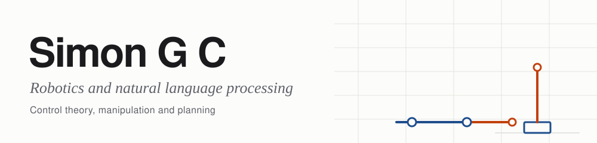

<picture>
  <source media="(prefers-color-scheme: dark)" srcset="assets/banner-dark.svg">
  
</picture>

I'm an electronics engineer based in Nepal, interested in robotics and natural language processing. Most of all I want to bridge control theory with manipulation and planning. My long term goal is a robot general enough to build its own vocabulary of skills in the physical world and reuse them, so it can be a generalist.

> **Now:** Sr. Research Assistant at Fonepay. Applying for robotics PhD programs. Learning MuJoCo and reinforcement learning on the side.

[**Portfolio**](https://simon.gc-np.com) &nbsp;&nbsp;/&nbsp;&nbsp; [**CV**](https://simon.gc-np.com/Simon_G_C_CV.pdf) &nbsp;&nbsp;/&nbsp;&nbsp; [**LinkedIn**](https://www.linkedin.com/in/simon-gc-880163241) &nbsp;&nbsp;/&nbsp;&nbsp; [**Email**](mailto:simongc28@gmail.com)

<picture>
  <source media="(prefers-color-scheme: dark)" srcset="assets/pixels-dark.svg">
  
</picture>

## Learning right now

I'm working through MuJoCo and using it for reinforcement learning. Both are unfinished and I keep adding to them.

| Repo | What it is |
|---|---|
| [mujoco-101](https://github.com/Simon000001/mujoco-101) | Short scripts on stepping a model, position actuators and rendering video |
| [pendulum-rl](https://github.com/Simon000001/pendulum-rl) | A PPO policy that balances an inverted pendulum on a cart |

## Selected work

| Project | Summary |
|---|---|
| [Swarm search robots](https://simon.gc-np.com/#swarm) | A 10 robot swarm controller evolved with PSO in Webots, and a real robot with PID odometry and an ultrasonic scanner |
| [EMG prosthetic arm](https://simon.gc-np.com/#emg) | Two channel EMG circuit and an SVM gesture classifier driving a 3D printed hand. First place, LOCUS 2020 |
| [Traffic violation detection](https://simon.gc-np.com/#traffic) | YOLOv5s detection and plate reading on CCTV footage ([code](https://github.com/Simon000001/yolov5_for_liscence_plate_detection_with_OCR)) |
| [Self balancing flywheel bike](https://simon.gc-np.com/#bike) | MPU6050 with a complementary filter and PID, balanced for up to 2 minutes on a slope |
| [nizipos](https://simon.gc-np.com/#industry) | An NFC payment device taken from concept to market deployment |

## Tools

Python, C, C++ &nbsp;|&nbsp; ROS 2, MuJoCo, Webots &nbsp;|&nbsp; STM32, ESP32, Arduino &nbsp;|&nbsp; YOLOv5 &nbsp;|&nbsp; KiCad, Fusion 360
